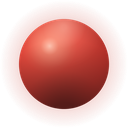

    <h1 class="wordmark" aria-label="ESHRAQ">ESHRAQاشـــراق</h1>
    

    
ESHRAQ is coming to Steam in Early Access. Leave your email to hear when it is out, and to get new devlogs and posts from the <a href="/">process log</a> as they are published.

    

        <iframe src="https://alllesss.substack.com/embed" class="newsletter-iframe" frameborder="0" scrolling="no" title="Subscribe to the ESHRAQ newsletter on Substack"></iframe>
    

    
Unsubscribe any time.

    

        <a href="/">Process log</a>/<a href="/about/">About</a>/<a href="https://instagram.com/alless0" target="_blank" rel="noopener noreferrer">@alless0</a>
    

